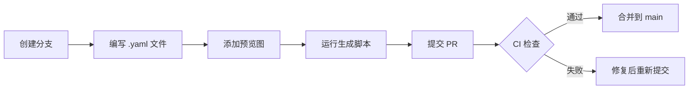

# Contributing — 风格协作指南

欢迎贡献风格提示词！本文档说明如何通过 PR 提交新风格。

## ⚡ 快速流程

```bash
# 1. 创建分支
git checkout -b feat/my-new-style

# 2. 创建风格文件（YAML，切勿照抄旧版 Markdown 模板）
$EDITOR styles/分类/my_style_name.yaml

# 3. 放入自己的配图（命名必须整段锚定）
#    images/styles_previews/{style_id}_{8位后缀}.webp（+ .thumb.webp）
python3 scripts/convert_to_webp.py --input /tmp/preview.jpg \
    --style-id my_style_name --output images/styles_previews/

# 4. 校验新文件（有 error 会 exit 1）
python3 scripts/validate_style.py styles/分类/my_style_name.yaml

# 5. 重新生成数据 + 画廊 + 索引（三者都必须提交，CI 会校验一致性）
python3 scripts/generate_data.py
python3 scripts/build_gallery.py
python3 scripts/generate_index.py

# 6. 提交
git add -A
git commit -m "feat: add my_style_name (#N)"
git push origin feat/my-new-style
```

> ⚠️ 依赖：`pyyaml`、`Pillow`。本机可用 `uv run --with pyyaml --with pillow python3 scripts/...`。

## 分支命名

| 分支类型 | 前缀 | 示例 |
|----------|------|------|
| 新风格 | `feat/` | `feat/cyberpunk_portrait` |
| 修复 | `fix/` | `fix/missing_field_in_x` |
| 文档 | `docs/` | `docs/update_readme` |

## 风格文件规范

### 文件路径

```
styles/分类/风格名.yaml
```

### 分类目录

共 12 个分类（`validate_style.py` 的 `VALID_CATEGORIES` 是唯一权威清单）：

| 目录 | 说明 |
|------|------|
| `social_media` | 社交媒体/短视频 |
| `brand_kv` | 品牌主视觉/海报 |
| `e-commerce` | 电商/产品展示 |
| `editorial` | 杂志封面/编辑排版/字体实验 |
| `fashion` | 时尚/穿搭 |
| `ip_character` | IP角色/盲盒 |
| `print` | 印刷品/杂志 |
| `science` | 科普/数据可视化 |
| `travel` | 旅行/目的地 |
| `typography` | 字体排版（文字为主的设计） |
| `creative` | 创意/实验性 |
| `vigo_cookbook` | Vigo食谱风格 |

不确定时选 `creative/`。

### 文件名规则

- 小写字母 + 下划线：`my_style_name.yaml`
- 不超过 60 个字符
- 不要用空格、连字符、大写
- 必须放在 `styles/{分类}/` 子目录下，必须是 `.yaml` 后缀（`.yml` 或放在 `styles/` 根目录会被跳过）

### 字段规范（YAML）

> ⚠️ 本仓库从 2026-06-28 起已**全面 YAML 化**。旧版 Markdown 模板（`**标签**：`／``）已废弃——
> `` 是**非法 YAML**，会导致 `yaml.scanner.ScannerError`、该风格被整条跳过（2026-06-29 事故）。

```yaml
# {中文名，可附英文原名}

id: my_style_name              # 与文件名一致；缺失时按文件名兜底
name: "{中文名}"
name_cn: "{中文名，可选}"        # 旧文件在用，可选
category: creative             # 必须是 12 个分类之一

tags:                          # 3-6 个高信息量标签，避免 using/with/into 等连接词
  - {标签1}
  - {标签2}

triggers:                      # 中文别名（用户会怎么找这个风格）
  - {触发词1}

features:                      # 3-5 条，字符串或 {title, desc} 二选一
  - "**{特点1}** — {说明}"

scene: "{适用场景}"
ratio: "{比例，如 3:4 或 16:9 / 3:4}"
summary: "{一句话理解}"

prompt: |
  {可直接套用的完整生图 Prompt，含 {变量} 占位符，≥80 字符}
  不要水印，不要真实Logo，不要电商广告感。

variables:                     # ★ 标准形态：[{kv_var, style_var}]，两个键都必填
  - kv_var: 画面-主体
    style_var: "{人物对象}"
    desc: "如：a musician / a poet"

source_url: "{来源链接}"        # 无链接时必须填 source_author
source_author: "{作者名}"

# 配图: images/styles_previews/my_style_name_{8位后缀}.webp
```

**要点**

- `prompt` 必填且 ≥80 字符——详情页「📋 复制提示词」直接复制该字段，`validate_style.py` 会拒绝空/占位内容。
- `variables` 用标准形态；旧形态 `['中文标题', ...]` 仍可解析，但无法表达英文替换值，校验会提示迁移。
- `source_url` 与 `source_author` **不能同时为空**（详情页必须有出处）。
- 不要在 yml 里写图片 URL：`generate_data.py` 从 `images/styles_previews/` 按文件名解析。
- yml 里的 `code` 字段无效——编号由 `generate_data.py` 按收录顺序重算并持久化到 `data/style_numbers.json`。

### 参考配图

- 将预览图放入 `images/styles_previews/`
- 命名格式：`{style_id}_{8位后缀}.{ext}` + 同名前缀的 `.thumb.webp`
  - 后缀是 md5(原图)[:8]，或 X/Twitter 的 media id（也是 8 位）
  - 缩略图由 `convert_to_webp.py` / `generate_data.py` 自动生成（400px，必需，缺了封面会 404）
- 可使用 `python3 scripts/convert_to_webp.py` 自动处理（全尺寸 1000px + 缩略图 400px）
- ⚠️ **`style_id` 必须与 yml 的 id 完全一致**，且**禁止用前缀模糊匹配找配图**：
  `doodle_style` 用前缀会命中 `doodle_style_poster_*.webp`，曾导致配图串号 + 真图被当"孤儿"误删
  （2026-10-10 事故）。`generate_data.py` 现按**整段锚定**解析，`check_style_previews.py --strict` 会拦截串号。

## PR 提交流程



### PR 前必做

```bash
# 1. 格式验证（--strict：有 error 即失败）
python3 scripts/validate_all.py --strict

# 2. 查重检测
python3 scripts/check_duplicate.py

# 3. 重新生成数据 + 画廊 + 索引（三者都必须提交）
python3 scripts/generate_data.py
python3 scripts/build_gallery.py
python3 scripts/generate_index.py

# 4. 配图完整性（含串号/孤儿检查，CI 用 --strict）
python3 scripts/check_style_previews.py --strict

# 5. 发布前安全扫描（对外推送前必做）
# 由 .git/hooks/pre-push 自动调用（脚本在 agent 侧 scripts/github-manager/pre-push-security-scan.py）
bash .git/hooks/pre-push
```

### PR 注意事项

1. **CI 必须通过** — `on-push-styles.yml` 在 PR 上跑 `validate_all.py --strict`、`check_duplicate.py --pr-mode`、`--check-images --no-strict`；`on-merge-main.yml` 在合并后**以及任何直推 main**时重算生成物并断言零 diff。本地通过 ≠ CI 通过。
2. **生成文件必须提交** — `data/styles.json`、`data/styles_list.txt`、`gallery.html`、`gallery.css`、`gallery-runtime.js`、`styles/_index.md`、`styles/*/_index.md` 的变更都要在 PR 里；`on-merge-main.yml` 会重算并断言零 diff。
3. **索引不许手改** — `_index.md` 一律由 `generate_index.py` 从磁盘重算（曾长期停在 167 个风格、缺 editorial/typography）。

## CI 工作流

| 工作流 | 触发时机 | 做什么 |
|--------|----------|--------|
| `on-push-styles.yml` | PR 提交/更新（`styles/**`） | `validate_all.py --strict` + `check_duplicate.py --pr-mode` + `--check-images --no-strict` |
| `on-merge-main.yml` | PR 合并到 main | 重新验证 + `styles.json`/`gallery.html` 一致性 + 配图完整性 `--strict` + `_index.md` 新鲜度 |
| `check-images.yml` | 图片/数据变动 + 每日 3 点 | 预览图 URL 可达性 |
| `manual-deploy.yml` | 手动触发 | 验证 + 一致性检查 |

> ⚠️ 注意：CI 不自动推送生成文件到 main。每次 PR 必须自己运行生成脚本并提交变更。

## 风格编号

每个风格有固定编号：`ST000001`、`ST000002`…

- 编号由文件遍历顺序决定，不随删除/插入改变
- 可在画廊页面点击编号复制

## 快速参考

```bash
# 验证单个文件（有 error exit 1）
python3 scripts/validate_style.py styles/分类/文件.yaml

# 验证全部文件（--strict：有 error exit 1）
python3 scripts/validate_all.py --strict

# 查重
python3 scripts/check_duplicate.py

# 生成 JSON 数据
python3 scripts/generate_data.py

# 生成画廊页面
python3 scripts/build_gallery.py

# 生成索引
python3 scripts/generate_index.py

# 配图完整性（串号/缩略图/孤儿；CI 用 --strict）
python3 scripts/check_style_previews.py --strict
```

## 有其他问题？

- 画廊功能清单与路线图：`docs/GALLERY_FEATURES.md`
- Agent 自动配置与脚本速查：`AGENT_SETUP.md`
- 收集提示词的完整 11 步流程：`style-collection` 技能（`~/.agents/skills/style-collection/SKILL.md`）
